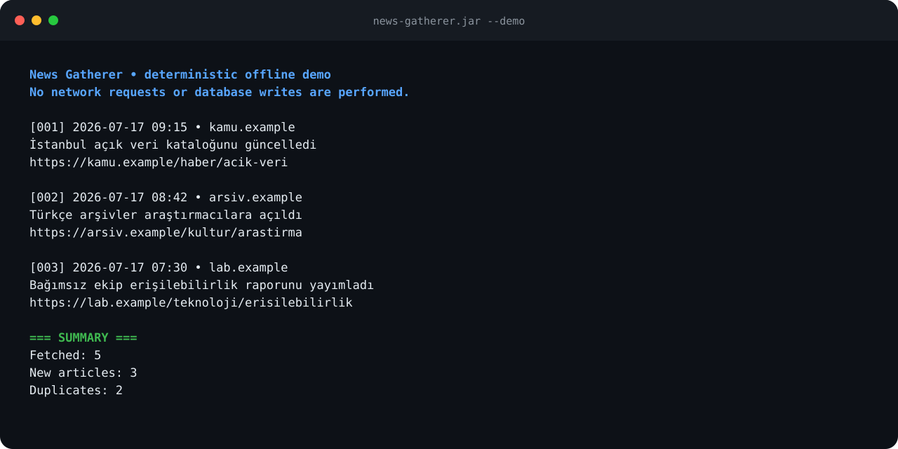

# News Gatherer

A lean Java 25 CLI that pulls Turkish articles from the GDELT DOC 2.0 API, deduplicates them by canonical URL, and stores every fresh story in a local SQLite database for later analysis.



The proof above is generated from `java -jar target/news-gatherer.jar --demo`. CI rebuilds the packaged JAR and refuses the change if its real renderer drifts from the committed asset.

## Quick Start

```bash
mvn clean package
java -jar target/news-gatherer.jar
```

For a network-free product walkthrough that does not create a database:

```bash
java -jar target/news-gatherer.jar --demo
```

### Backfill Entire Weeks

Use the CLI flags to cover a long lookback by recursively splitting windows that fill the 200-record request limit. Example: fetch the last 7 days using 1‑hour slices (the default window) while respecting the built-in 5 second request spacing (so a week of 1 hour windows takes a while):

```bash
mvn clean package
java -jar target/news-gatherer.jar --lookback=7d --window=1h
```

Other useful flags:

- `--query=...` – override the default `sourcecountry:turkey sourcelang:turkish` query
- `--timespan=...` – single-run timespan (e.g., `30m`, `2h`) when not using backfill mode
- `--window=...` – chunk size for the backfill loop (supports `m`, `h`, `d` suffixes)
- `--json-output=...` – write newline-delimited JSON of new articles (from the latest run) to the given path
- `--demo` – render deterministic synthetic output without network or database access

Backfill stops splitting at 30-minute windows. If one of those smallest windows still fills the 200-record request, the CLI warns that some results may be truncated; it does not claim exhaustive capture for an unusually dense interval.

### Hand Off to News Extractor

After each run, the SQLite backlog can be inspected with the companion [News Extractor](https://github.com/okanerturan/news-extractor) project, whose README documents the downstream workflow:

```bash
cd ../news-extractor
python -m pip install --no-deps --editable .
python examples/scrape_news_gatherer_backlog.py \
  --db ../news-gatherer/output/news-gatherer.db \
  --limit 50 --format json > backlog.jsonl
```

Then use `examples/view_jsonl.py` or `examples/backlog_viewer.html` to review extractions. This keeps the Java collector and Python extractor in sync without duplicating logic.

## What It Does

1. **Fetches** up to 200 Turkish articles from GDELT’s `/doc` API over the last 2 hours (configurable), and warns whenever a response fills that request limit.
2. **Canonicalizes** URLs by trimming tracking parameters (`utm_*`, `fbclid`, etc.) and trailing slashes so different share links collapse to the same key.
3. **Deduplicates** incrementally via SQLite (`output/news-gatherer.db`). Once a canonical URL is seen, it will be skipped for the next 7 days (retention window).
4. **Persists atomically**: new seen-URL keys and their article rows commit in one transaction, so a failed article write cannot silently suppress the story on a later run.
5. **Reports** new articles in recency order with fetched/new/duplicate counts.

### Storage Layout

- Database: `output/news-gatherer.db`
- `seen_urls(canonical_url TEXT PRIMARY KEY, first_seen INTEGER)`
- `articles(id INTEGER PK, url, title, domain, language, source_country, seen_date, published_date, canonical_url, stored_at)`
- Inspect with `sqlite3 output/news-gatherer.db 'SELECT title, domain FROM articles ORDER BY id DESC LIMIT 5;'`

## Example Output

```
[001] 2025-11-09 03:45 • aa.com.tr
      Cumhurbaşkanı Erdoğan yurda döndü
      https://www.aa.com.tr/tr/politika/cumhurbaskani-erdogan-yurda-dondu/123456

[002] 2025-11-09 03:42 • hurriyet.com.tr
      İstanbul'da kuvvetli fırtına uyarısı
      https://www.hurriyet.com.tr/gundem/istanbulda-kuvvetli-firtina-uyarisi-123456

=== SUMMARY ===
Fetched:      153
New articles: 42
Duplicates:   111
```

## Architecture

```
src/main/java/com/newsgatherer/
├── GdeltNewsGatherer.java          // CLI entry point & workflow orchestration
├── config/Config.java              // Tunables (API, rate limits, storage)
├── domain/Article.java             // Record for parsed articles
├── client/GdeltApiClient.java      // HTTP client + rate limiting + JSON fetch
├── parser/ArticleParser.java       // JSON → Article mapping & canonicalization
├── output/ArticlePrinter.java      // Console formatting for new articles
└── storage/ArticleRepository.java  // SQLite persistence + seen-url tracking
```

No DI, no frameworks, no background services—just a few single-purpose classes wired together in the CLI.

## Configuration

Key knobs in `config/Config.java`:

```java
// GDELT API
public static final String GDELT_API_ENDPOINT = "https://api.gdeltproject.org/api/v2/doc/doc";
public static final int MAX_ARTICLES = 200;         // request size (≤250)
public static final String DEFAULT_TIMESPAN = "2h"; // window per run
public static final Duration MIN_REQUEST_INTERVAL = Duration.ofMillis(5000); // one request per 5 s
public static final int MAX_ATTEMPTS = 4;           // 1 try + 3 retries on 429/5xx

// Storage
public static final String OUTPUT_DIR = "output";
public static final String DATABASE_FILE = OUTPUT_DIR + "/news-gatherer.db";
public static final Duration SEEN_URL_RETENTION = Duration.ofDays(7);
```

### Environment Overrides

You can customize deployment settings without editing the source by exporting these variables:

| Variable | Default | Description |
| --- | --- | --- |
| `NEWS_GATHERER_OUTPUT_DIR` | `output` | Directory for generated artifacts. |
| `NEWS_GATHERER_DATABASE_FILE` | `<OUTPUT_DIR>/news-gatherer.db` | Absolute/relative path to the SQLite database. |
| `NEWS_GATHERER_SEEN_RETENTION_DAYS` | `7` | Number of days to keep URLs in the `seen_urls` cache. |
| `NEWS_GATHERER_MIN_REQUEST_INTERVAL_MS` | `5000` | Minimum milliseconds between requests (rate limit). |
| `NEWS_GATHERER_MAX_ATTEMPTS` | `4` | Total tries per request when GDELT answers 429 or 5xx. |
| `NEWS_GATHERER_RETRY_BASE_DELAY_MS` | `5000` | First backoff delay; doubles per retry, plus up to 25% jitter, capped at 120 s. |

## GDELT Constraints & Tips

- The DOC API permits up to 250 rows, while this client deliberately requests 200. A full 200-record response may be truncated: shorten a single-run `--timespan`, or use backfill mode so saturated windows split recursively down to 30 minutes.
- GDELT does not expose article bodies or summaries—only metadata. For Ground-News‑style comparisons you’d need to fetch each URL yourself.
- Rate limiting is mandatory. GDELT answers 429 with "limit requests to one every 5 seconds", so the CLI waits 5 seconds between requests by default. On 429 or 5xx it retries with exponential backoff and jitter (honouring `Retry-After` if sent) and then fails with the status and total wait. The throttle can outlast a few retries if you have been polling recently; wait a few minutes and run again.
- A 200 with an empty body or `{}` is not the same as "no articles". GDELT sends it for throttled or invalid queries, so the CLI prints "GDELT returned nothing: the query may be invalid or throttled" and exits with code 3. A genuine zero-result answer prints "No articles found." and exits 0.

### Exit codes

| Code | Meaning |
| --- | --- |
| 0 | Run finished (including a valid answer with zero articles). |
| 1 | Failure, such as retries exhausted on 429/5xx or a non-JSON reply. |
| 3 | GDELT returned nothing (empty body or `{}`); in backfill, at least one window did. |

## How It Works Internally

1. **HTTP** – `GdeltApiClient` builds the query string (`mode=artlist`, `timespan`, `maxrecords`) and uses Java’s `HttpClient` with HTTP/2 and a built-in rate limiter.
2. **Parsing** – `ArticleParser` reads the JSON, handles both `articles` and `artlist` payloads, and maps each node to an `Article` record.
3. **Canonicalization** – Domains fall back to the URL host and are lowercased via `Locale.ROOT`; tracking params and URL fragments are stripped without changing path or query-value case.
4. **Deduplication** – `seen_urls` is loaded at startup, pruned (entries older than 7 days deleted), and updated with `INSERT OR IGNORE` for each new canonical URL.
5. **Persistence** – `ArticleRepository` commits fresh seen keys and article rows in one SQLite transaction, with ISO-8601 timestamps and the run’s `stored_at` epoch so downstream tooling can group by ingest. A failed article insert rolls the seen key back for a safe retry.
6. **Display** – `ArticlePrinter` shows new items in reverse chronological order along with run-level metrics so you can spot anomalies quickly.

## Modern Java Features in Play

- **Records** for `Article` (immutable, concise data carrier)
- **`Stream.toList()`** for tidy collection materialization without collectors
- **Text blocks** for multi-line SQL DDL/insert statements

## Development Notes

- `sqlite3 output/news-gatherer.db` is the fastest way to explore historical runs. Keep ad‑hoc queries in `data/` if they become reusable.
- When adding new metadata columns, update the `articles` table DDL and the insert statement; SQLite will retain existing rows (new columns default to `NULL`).
- Run `mvn clean verify` before sharing changes—Checkstyle is wired into the build and enforces basic hygiene.
- CI retains the runnable shaded JAR for seven days and verifies the README proof from that exact artifact. A durable GitHub Release remains intentionally gated on an explicit licensing decision.

Happy collecting!
